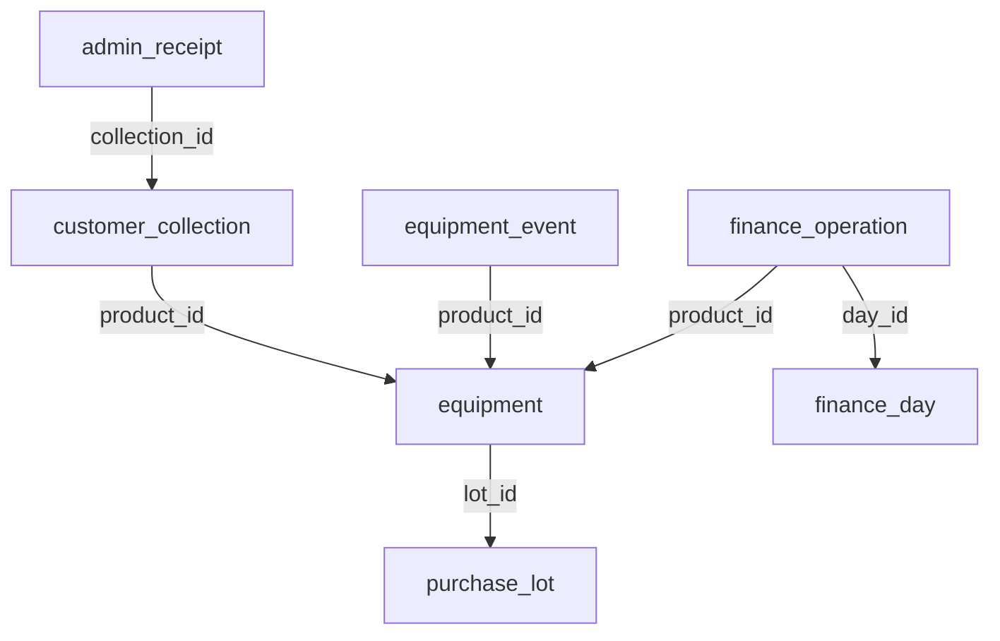
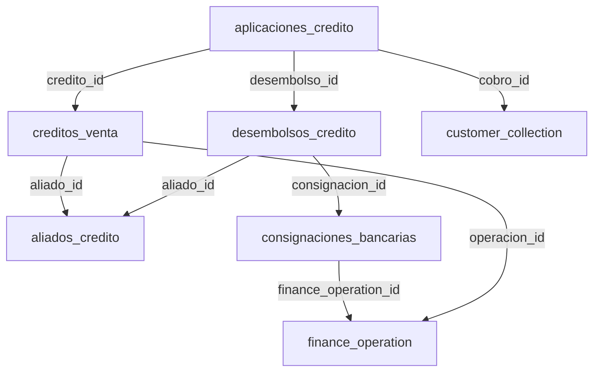
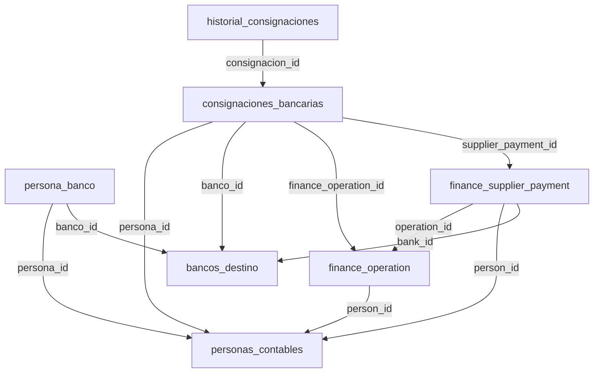
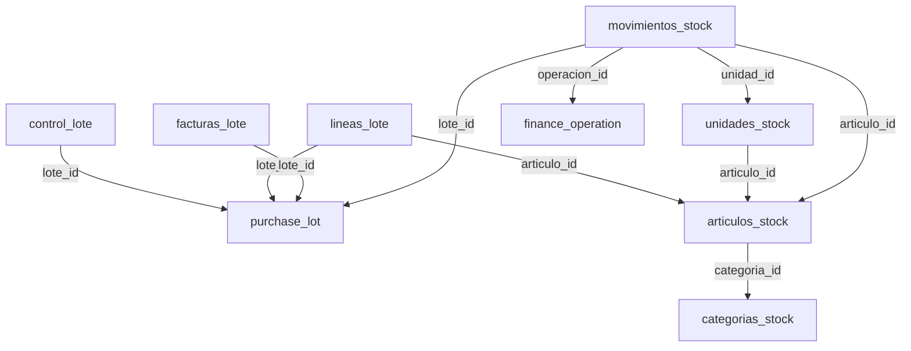
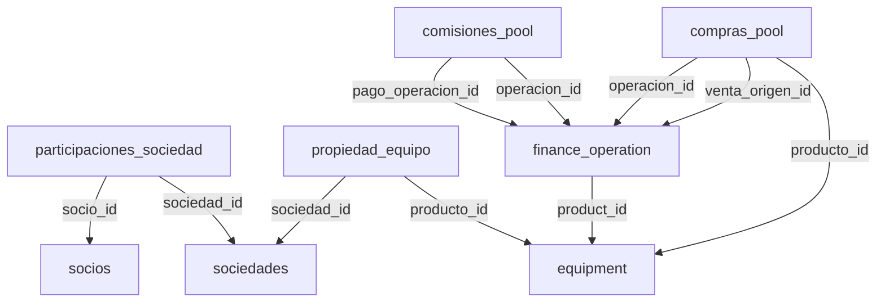
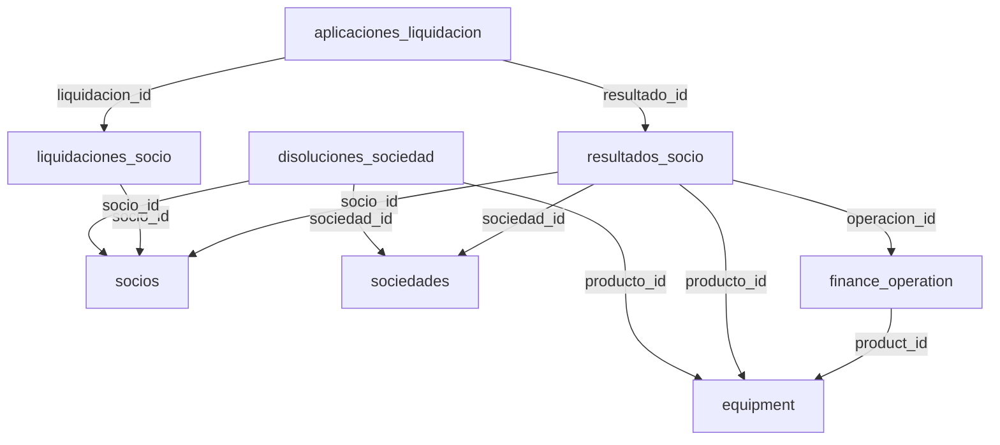

# Relaciones declaradas en modelos

Flechas: tabla con clave foránea -> tabla referenciada. Diagramas parciales por dominio; no expresan todas las reglas de cardinalidad. Todas las FK están en esquema_modelos.json. Los JSON tienen relaciones lógicas adicionales no protegidas por FK.

## Operación y cobros

## Créditos

## Bancos y personas

## Artículos y compras

## Sociedades y POOL

## Liquidaciones

